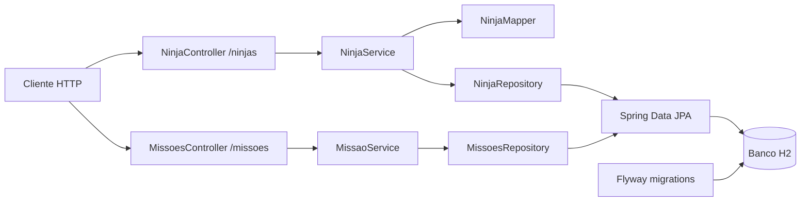
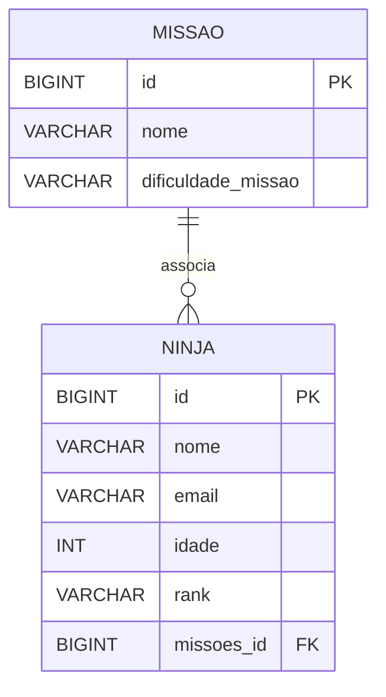

# EM CONSTRUÇÃO

# Cadastro de Ninjas

API REST para cadastro e consulta de ninjas e missões, desenvolvida com Java 21 e Spring Boot. O projeto usa Spring Data JPA para persistência, H2 como banco de dados e Flyway para versionar o schema. Também inclui uma página web simples para listar ninjas.

## Tecnologias

- Java 21
- Spring Boot 3
- Spring Web e Spring Data JPA
- H2 Database
- Flyway
- Maven
- Lombok

## Estrutura do projeto

```text
src/
├── main/
│   ├── java/dev/java10x/CadastroDeNinjas/
│   │   ├── CadastroDeNinjasApplication.java   # Inicialização do Spring Boot
│   │   ├── exception/                         # Tratamento global de erros
│   │   ├── Missoes/
│   │   │   ├── controller/                    # Endpoints de missões
│   │   │   ├── domain/                        # Tipos do domínio, como dificuldade
│   │   │   ├── dto/                           # Objetos de transferência de dados
│   │   │   ├── mapper/                        # Mapeadores (o de missões está em desenvolvimento)
│   │   │   ├── repository/                    # Persistência de missões
│   │   │   ├── service/                       # Regras de negócio de missões
│   │   │   └── MissaoModel.java               # Entidade de missão
│   │   └── Ninjas/
│   │       ├── controller/                    # API REST e página web de ninjas
│   │       ├── dto/                           # Objeto de transferência de dados
│   │       ├── mapper/                        # Conversão entre DTO e entidade
│   │       ├── repository/                    # Persistência de ninjas
│   │       ├── service/                       # Regras de negócio de ninjas
│   │       └── NinjaModel.java                # Entidade de ninja
│   └── resources/
│       ├── db/migrations/                     # Migrações SQL do Flyway
│       ├── templates/                         # Templates HTML
│       └── application.properties             # Configuração da aplicação
└── test/                                      # Testes automatizados
```

## Visão geral



Um ninja pode estar associado a uma missão. A chave estrangeira `missoes_id` fica na tabela de ninjas:



## Executar localmente

É necessário ter o JDK 21 instalado. Na raiz do projeto, execute:

```bash
./mvnw spring-boot:run
```

No Windows, use `mvnw.cmd spring-boot:run`. Para executar os testes:

```bash
./mvnw test
```

## Endpoints disponíveis

| Método | Caminho | Descrição |
|---|---|---|
| `POST` | `/ninjas/adicionar` | Cadastra um ninja |
| `GET` | `/ninjas/listar` | Lista os ninjas |
| `GET` | `/ninjas/listar/{id}` | Consulta um ninja |
| `PUT` | `/ninjas/alterar/{id}` | Atualiza um ninja |
| `DELETE` | `/ninjas/deletar/{id}` | Remove um ninja |
| `GET` | `/missoes/listar` | Lista as missões |
| `POST` | `/missoes/criar` | Cadastra uma missão |
| `GET` | `/ninjas/ui/listar` | Exibe a página HTML de ninjas |

As rotas de alteração e remoção de missões ainda são placeholders.
